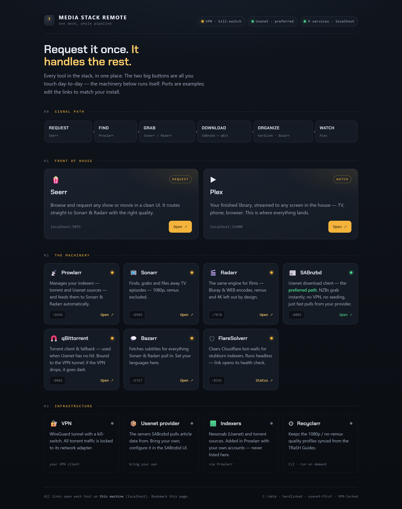
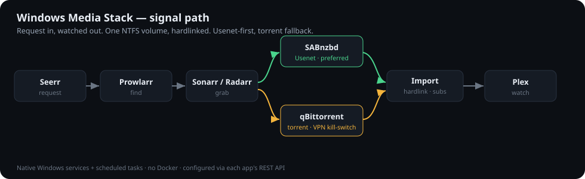

# Windows Media Stack


A **native-Windows, no-Docker** home media automation stack — the full *arr suite
(Prowlarr, Sonarr, Radarr, Bazarr), SABnzbd + qBittorrent, a request front-end, and
Plex — installed as real Windows services and scheduled tasks, configured entirely
through each app's REST API, with a VPN kill-switch, hardlink-based storage, and an
operational runbook an AI agent (Claude Code) can drive.



> The repo includes the **[Media Stack Remote](dashboard/media-stack-remote.html)** above — one self-contained page that fronts the whole stack, grouped by what each tool does. Bookmark it as the only link you need. It reflows for the couch, too: [narrow view](docs/images/dashboard-mobile.png).

Most published "arr stacks" are Docker Compose files that run Linux containers. This
one deliberately isn't: it targets people running everything **directly on Windows**,
with no Docker Desktop, no WSL2, no containers. That path is common in practice and
badly under-documented — this repo is the playbook.

---

## ⚖️ Responsible use

This repository documents **infrastructure and automation** for a self-hosted media
library and Plex server. It does not include, endorse, or link to any source of
copyrighted material.

- Indexers, trackers and Usenet providers are **yours to bring and configure**, in
  line with the law in your jurisdiction and the terms of the services you use.
- No indexer names, tracker names, API keys, provider credentials, or personal data
  appear anywhere in this repo. Everything secret is templated in [`.env.example`](.env.example).
- Private trackers in particular should **never** be named in a public repo — doing so
  violates most trackers' rules. Keep yours in your local `.env` only.

Use it to manage media you have the right to access, and respect copyright.

---

## Architecture at a glance



```
Request (Seerr)  →  Find (Prowlarr)  →  Grab (Sonarr / Radarr)
      →  Download  →  Organize            →  Watch (Plex)
         ├ Usenet: SABnzbd (preferred)     ├ hardlink into library
         └ Torrent: qBittorrent (VPN)      └ subtitles: Bazarr
```

Everything lives under **one root on one NTFS volume** (`C:\data`) so that downloads
and the library can be **hardlinked** — one copy on disk, seedable and importable at
once. See [`docs/architecture.md`](docs/architecture.md).

| Component | Role | Default port | Runs as |
|---|---|---|---|
| Prowlarr | Indexer manager | 9696 | Windows service |
| Sonarr | TV automation | 8989 | Windows service |
| Radarr | Movie automation | 7878 | Windows service |
| Bazarr | Subtitles | 6767 | Scheduled task (logon) |
| SABnzbd | Usenet download client | 8085 | Scheduled task (logon) |
| qBittorrent | Torrent client (VPN-bound) | 8081 | User app |
| Seerr | Request front-end | 5055 | Scheduled task (logon) |
| FlareSolverr | Cloudflare solver | 8191 | Scheduled task (logon) |
| Recyclarr | TRaSH quality profiles | — | CLI, on demand |
| Plex | Player / library | 32400 | Windows service |

Ports are examples and configurable; `8080` is intentionally avoided because other
Windows software commonly claims it.

## What makes this one different

- **No Docker.** Native services (`sc.exe`) and logon scheduled tasks, not containers.
  Includes the fiddly bits nobody writes down: creating the Sonarr service by hand,
  running SABnzbd via its console exe from a hidden launcher (the native 5.x service
  is broken on Windows), and Bazarr's base-Python quirk.
- **API-driven configuration.** The whole stack is configured by calling each app's
  REST API from PowerShell — reproducible and scriptable — instead of clicking through
  web UIs. See [`scripts/`](scripts/) and [`docs/configuration.md`](docs/configuration.md).
- **Native VPN kill-switch.** qBittorrent is bound to the VPN's network interface, so
  if the VPN drops the torrent client goes dark — no Gluetun container needed. Includes
  the stale-binding failure mode and its fix. See [`docs/vpn-killswitch.md`](docs/vpn-killswitch.md).
- **Usenet-first, torrent-fallback routing.** A delay profile prefers Usenet and only
  falls back to torrents after a wait. See [`docs/configuration.md`](docs/configuration.md).
- **Opinionated custom formats**, including an audio-language requirement and an
  audio-description blocker. See [`docs/custom-formats.md`](docs/custom-formats.md).
- **Agent-operable.** [`CLAUDE.md`](CLAUDE.md) is a living runbook: open this repo in
  Claude Code and it can configure, verify, and troubleshoot the stack with you.

## Repository layout

```
.
├── README.md                     # you are here
├── CLAUDE.md                     # operational runbook for Claude Code
├── .env.example                  # every config value + secret, templated
├── docs/                         # architecture, install, config, hard-won fixes
├── config/
│   ├── recyclarr/                # TRaSH quality-profile configs (keys templated)
│   └── custom-formats/           # importable custom-format JSON (Danish audio, AD block)
├── scripts/                      # numbered PowerShell API-automation (01–07) + autostart
├── dashboard/                    # one-page "remote" that links every local tool
└── .github/workflows/            # CI: gitleaks secret scan + PSScriptAnalyzer lint
```

## Getting started

1. Read [`docs/architecture.md`](docs/architecture.md) and the original design
   [`docs/build-spec.md`](docs/build-spec.md).
2. Copy `.env.example` → `.env` and fill in your own ports, paths, keys, and services.
3. Follow [`docs/installation.md`](docs/installation.md) to install the apps natively.
4. Run the numbered scripts in [`scripts/`](scripts/) in order (or let Claude Code drive
   them): `01` folders + hardlink test → `02` download clients → `03` indexers →
   `04` quality profiles → `05` delay profiles → `06` custom formats → `07` verify.
5. Run the hardlink verification test in [`docs/installation.md`](docs/installation.md)
   before importing anything real.

## Status

Phase 1: single-volume proof of concept on an internal SSD. Phase 2 (migration to a
dedicated NTFS drive) is documented in [`docs/build-spec.md`](docs/build-spec.md §7).

## Credits

Built on the open-source [Servarr](https://wiki.servarr.com/) suite and the
[TRaSH Guides](https://trash-guides.info/). Scaffolded and operated with
[Claude Code](https://claude.com/claude-code).
